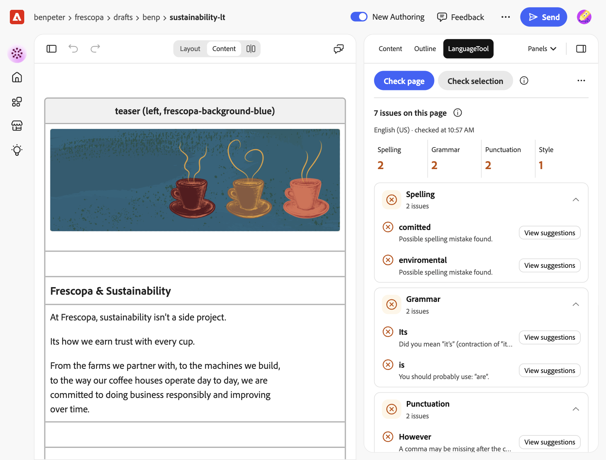
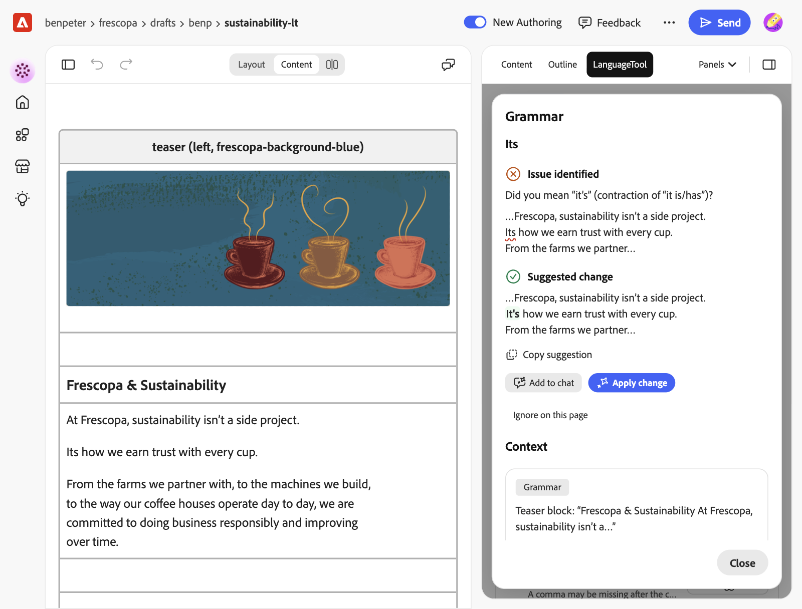

# LanguageTool for Experience Workspace

A plugin for [Adobe Experience Workspace](https://da.live) (DA). Authors use it to
proofread the page they are editing: it checks spelling, grammar, punctuation and
style in more than 30 languages and lists what it finds next to the page.



On sites with Workspace chat, it works with the assistant. On an issue, **Add to
chat** puts the exact change into the assistant's prompt, and **Apply change** asks
the assistant to make it. **Ask the assistant to fix these** hands over the whole list
at once. Authors can also fix a selection in place without the assistant, and keep
brand names in a site dictionary.



The checks come from [LanguageTool](https://languagetool.org). A site can use
LanguageTool's free API, each author's own Premium account, or its own LanguageTool
server. This plugin is not made or endorsed by LanguageTooler GmbH, the company
behind LanguageTool.

This README is for site admins who want to add the plugin to a site. For how to use
it, see the [author guide](docs/authors.md).

## Before you start

- **A DA site.** The plugin works in Workspace's editor (the canvas) and reads the
  page through the Workspace SDK. It is tested on classic DA sites. Sites on the new
  AEM API (Helix 6) keep the settings in their editor config instead; that path is
  untested.
- **A choice of server.** See [Servers](#servers). The free API needs no account,
  but LanguageTool's [terms](https://languagetool.org/legal/terms) limit its services
  to "personal, non-commercial purposes" unless LanguageTool agrees in writing. For a
  business site, give authors Premium accounts or run your own server.
- **Write access to the site config** for authors who should add words to the site
  dictionary. Everyone else can still ignore a word until they close the panel.

## Add it to a site

1. Open the site config: `https://da.live/config#/{org}/{site}/`.
2. In the `library` sheet (add a tab called `library` if there is none), add a row:

   | title | path | icon |
   |---|---|---|
   | LanguageTool | `https://main--ew-languagetool--benpeter.aem.live/tools/plugins/languagetool/languagetool.html` | `https://main--ew-languagetool--benpeter.aem.live/tools/plugins/languagetool/icon.svg` |

   Leave `ref` and `experience` empty. The plugin opens as a side panel. The title is
   the name authors see in the Panels menu. Any name works, as long as no other
   library row uses it.
3. Optional: add a tab called `languagetool` with the columns `key` and `value` to
   change the defaults. See [Settings](#settings).
4. Save the config.
5. Open a page of the site in Workspace. "LanguageTool" is now in the **Panels** menu
   under Extensions.
6. Send your authors the [author guide](docs/authors.md).

To remove the plugin, first ask authors with a Premium key to remove it (**⋯** >
**Remove premium key**), then delete the row. Without the row they can't open the
panel to remove the key.

### Settings

All keys are optional.

| key | default | example | what it does |
|---|---|---|---|
| `server` | `free` | `premium`, `https://lt.example.com` | Where the text goes. See [Servers](#servers). |
| `language` | `auto` | `de-DE`, `en-GB` | `auto` detects the language of each check. A fixed language is more reliable for short texts. |
| `variants` | `en-US, de-DE` | `en-GB, de-CH, pt-BR` | With `auto`: the variant to use for languages that have several. LanguageTool only checks spelling when it knows the variant. |
| `level` | `default` | `picky` | `picky` adds rules for formal writing. |
| `disabledRules` | empty | `WHITESPACE_RULE, DE_CASE` | LanguageTool rule IDs to turn off, comma-separated. |
| `words` | empty | `Frescopa, Schamdan` | The site dictionary, comma-separated. There can be several `words` rows; the panel adds new words to the first one. |

### Run your own copy

The row above loads the code from this repository, so changes here go live for your
authors without review. The code can read the Premium keys authors save. To review
updates first, fork the repository, install
[AEM Code Sync](https://github.com/apps/aem-code-sync/installations/new) on the fork,
and set:

- `path`: `https://main--{repo}--{owner}.aem.live/tools/plugins/languagetool/languagetool.html`
- `icon`: `https://main--{repo}--{owner}.aem.live/tools/plugins/languagetool/icon.svg`

The Premium key and the privacy notice are stored per web address, so authors add
their key again after the switch and see the notice once more.

## Servers

| | Free API | Premium API | Your own server |
|---|---|---|---|
| `server` value | `free` | `premium` | its URL, for example `https://lt.example.com` |
| Account | none | each author's LanguageTool account and API key | none |
| Requests | 20 per minute per IP address | 80 per minute | your choice |
| Text per request | 20,000 characters | 60,000 characters | the panel sends up to 20,000 |
| Rules | standard | standard and premium rules | open-source rules only |

Limits are from LanguageTool's [public API page](https://dev.languagetool.org/public-http-api)
and [API reference](https://languagetool.org/http-api/), as of November 2026. The
panel splits longer pages at paragraph boundaries and sends the parts one after the
other.

- **Free API.** LanguageTool asks that nobody sends automated requests to it; the
  panel only checks when an author clicks a button. All authors behind one office IP
  address share the 20 requests a minute.
- **Premium API.** Each author adds their LanguageTool login email and API key under
  **⋯** > **Add premium key**. They get the key at
  [languagetool.org/editor/settings/access-tokens](https://languagetool.org/editor/settings/access-tokens).
  API plans are listed at [languagetool.org/proofreading-api](https://languagetool.org/proofreading-api).
  With `server` set to `free`, a saved key switches that author to Premium. With
  `server` set to `premium`, authors without a key are asked for one.
- **Your own server.** LanguageTool is open source ([LGPL 2.1](https://github.com/languagetool-org/languagetool)).
  Run its HTTP server and set `server` to its URL; the panel calls `{url}/v2/check`.
  The server must use https (`http://localhost` works for testing) and allow
  cross-origin requests: start it with `--allow-origin`. There is no official Docker
  image; [erikvl87/languagetool](https://hub.docker.com/r/erikvl87/languagetool) is a
  community one.

Never put an API key in the site config. Everyone who can read the config could copy
it.

## What data goes where

- **The text** of the page or the selection goes to the server above, only when an
  author clicks **Check page** or **Check selection**. HTML tags, link and image URLs,
  block names and the text of code, `metadata` and `section-metadata` blocks are not
  sent; short placeholders tell LanguageTool where paragraphs end. Nothing is sent
  while authors type. LanguageTool says it doesn't store texts sent to its API and
  runs its servers in Germany ([proofreading API page](https://languagetool.org/proofreading-api)).
- **The Premium key** stays in the author's browser, in local storage of the
  plugin's web address. Every site that loads the plugin from the same address shares
  it. The panel sends it only to `api.languagetoolplus.com`, never to a self-hosted
  server, to Adobe or into the site config.
- **The site dictionary** is saved in the site config, with the author's Workspace
  sign-in, when an author chooses **Add to site dictionary**. The panel also reads the
  org and site config to find its settings and whether Workspace chat is turned off.
- **The Workspace assistant** gets a prompt only when an author chooses **Add to
  chat**, **Apply change** or **Ask the assistant to fix these**. The prompt names the
  words, the paragraph and the fix, not LanguageTool's messages.
- **The privacy notice** is shown before the first check with a server, and the
  author's OK is remembered per server in local storage.

## Limits

- Fixes in place work on a selection. For an issue found with **Check page**, authors
  copy the fix, ask the assistant to make it, or select the text and use **Check
  selection**.
- Inside formatted text (bold, links), fixes in place work only when the selection
  covers whole paragraphs.
- One language per request. A page that mixes languages is checked in the language
  LanguageTool detects for it. Set a fixed `language` if detection gets it wrong.
- Page metadata is not checked: Workspace doesn't pass it to extensions.
- Issues don't become Workspace comments. Extensions can't create comments.
- Results are a snapshot. After editing, check again.
- Premium results for German were unstable when tested on 2026-11-11: the same text
  sometimes came back with no issues at all, while the free API found them. English
  Premium results were stable.

## Troubleshooting

| What the panel says | What to do |
|---|---|
| "LanguageTool's limit was reached" (HTTP 429) | Wait a minute. The free API allows about 20 checks a minute per network. |
| "This text is too long for one check" (HTTP 413) | Check a selection, or use Premium. |
| "Could not reach …" | The network blocks the server, or a self-hosted server doesn't allow cross-origin requests. The browser console has details. |
| "Select some text in the document first" | Select text in the editor before **Check selection**. |
| "The selection changed since the check" | Check the selection again, then apply. |
| "LanguageTool did not accept your premium key" (HTTP 401/403) | Remove the key in the **⋯** menu and add it again. |
| **Add to site dictionary** is missing | The author can't change the site config. Use **Ignore on this page**, or ask an admin to add the word to `words`. |

## Develop

```sh
npm ci
npm test
npm run lint
```

The code is plain ES modules with no build step and no runtime dependencies:

- `tools/plugins/languagetool/languagetool.html|js|css`: the panel
- `lib/text.js`: turns editor HTML into LanguageTool's annotated text and maps
  results back to paragraphs
- `lib/matches.js`: sorts and filters results, and writes the fix text and assistant prompts
- `lib/settings.js`: site settings, server choice, site dictionary
- `lib/api.js`: the LanguageTool request
- `lib/config.js`: reads and writes the site config
- `lib/selection.js`: replaces the selection after checking it didn't change

To try a local copy in Workspace, add a library row titled `LanguageTool (local)`
with path `/tools/plugins/languagetool/languagetool.html` and ref `local`, run
`aem up`, and open Workspace with `?ref=local`. Workspace loads paths that start with
`/` from `http://localhost:3000` for `local` rows.

## Licenses

Apache-2.0, see [LICENSE](LICENSE). The icons in `tools/plugins/languagetool/img/`
are copied from Experience Workspace (`https://da.live/img/icons/`).
