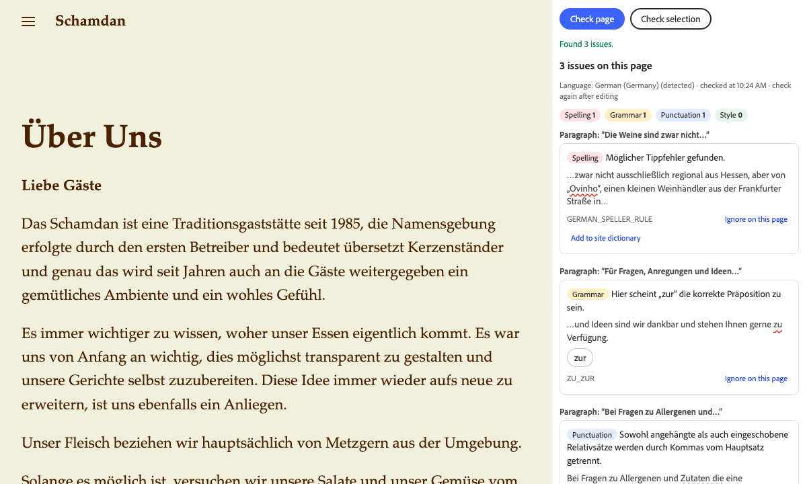

# LanguageTool for Experience Workspace

A proofreading panel for [AEM Experience Workspace](https://da.live). It checks the page you are editing with [LanguageTool](https://languagetool.org) and helps you fix what it finds: spelling, grammar, punctuation and style, in more than 30 languages.



It is for authors who publish in Experience Workspace and want a second pair of eyes before they hit preview, without copying text into another tool.

What you can do in the panel:

- Check page: lists every issue on the page, grouped by paragraph or block, with the flagged words underlined, LanguageTool's explanation and up to three suggestions. Counts at the top show spelling, grammar, punctuation and style separately.
- Check selection and fix it: select text in the document, check it, pick the suggestions you want and apply them. The panel replaces only the selected text.
- Site dictionary: names like your brand or a product LanguageTool doesn't know show up as spelling mistakes. Add them to the site dictionary once and they are ignored for every author on the site. Authors who can't change the site settings can ignore a word for the current page instead.
- Ask the Workspace assistant: on sites with Workspace chat, one button puts the list of issues into the chat prompt, so the assistant can fix them for you. Nothing is sent until you press send in the chat.

## Set it up

You need permission to edit the site configuration at `https://da.live/config#/{org}/{site}/`.

1. Open the site configuration, add a sheet (tab) called `library` if there is none, and add this row:

   | title | path | icon | experience | ref |
   | --- | --- | --- | --- | --- |
   | `LanguageTool` | `https://main--ew-languagetool--benpeter.aem.live/tools/plugins/languagetool/languagetool.html` | `https://main--ew-languagetool--benpeter.aem.live/tools/plugins/languagetool/icon.svg` | `inline` | |

   Keep any rows that are already there. Save.

2. Optional: add a sheet called `languagetool` with the columns `key` and `value` to change the defaults. All keys are optional.

   | key | default | example | what it does |
   | --- | --- | --- | --- |
   | `server` | `free` | `premium`, `https://lt.example.com` | Where the text goes. See [Servers](#servers). |
   | `language` | `auto` | `de-DE`, `en-GB` | `auto` detects the language of each check. A fixed language is more reliable for short texts. |
   | `variants` | `en-US, de-DE` | `en-GB, de-CH, pt-BR` | With `auto`: which variant to use for languages that have several. LanguageTool only checks spelling when it knows the variant. |
   | `level` | `default` | `picky` | `picky` adds rules for formal writing. |
   | `disabledRules` | empty | `WHITESPACE_RULE, DE_CASE` | LanguageTool rule IDs to turn off. The panel shows the rule ID under each issue. |
   | `words` | empty | `Schamdan, Ovinho` | The site dictionary, comma-separated. You can have several `words` rows. The panel adds words to the first one. |

3. Open a page in Experience Workspace, choose Panels, then LanguageTool.

The first time you check, the panel tells you where the text goes and asks you to continue.

## Servers

| | Free API | Premium API | Your own server |
| --- | --- | --- | --- |
| `server` value | `free` | `premium` | its URL, for example `https://lt.example.com` |
| Account | none | a LanguageTool account with an API key | none |
| Requests | 20 per minute per IP address | 80 per minute | your choice |
| Text per check | 20,000 characters | 60,000 characters | your choice (the panel sends up to 20,000 per request) |
| Rules | standard | standard plus premium rules | open-source rules only |

Limits are from LanguageTool's [public API page](https://dev.languagetool.org/public-http-api) and [API reference](https://languagetool.org/http-api/), as of November 2026.

Free API. Works without an account. LanguageTool asks that you don't send automated requests to it; the panel only checks when an author clicks a button. LanguageTool's [terms](https://languagetool.org/legal/terms) say the services are for "personal, non-commercial purposes" unless LanguageTool agrees otherwise in writing. If you use this for a business site, get a premium plan or run your own server.

Premium API. Each author enters their own LanguageTool login email and API key under Settings in the panel. Get the key at [languagetool.org/editor/settings/access-tokens](https://languagetool.org/editor/settings/access-tokens) after signing in. API plans are listed at [languagetool.org/proofreading-api](https://languagetool.org/proofreading-api). With `server` set to `free`, a saved key switches that author to premium; with `server` set to `premium`, authors without a key are asked for one.

Your own server. LanguageTool is open source ([LGPL 2.1](https://github.com/languagetool-org/languagetool)). Run its HTTP server and set `server` to its URL. The panel calls `{url}/v2/check`. The server must use https (`http://localhost` is allowed for testing) and must allow cross-origin requests: start the server with `--allow-origin` (without a value it allows any origin). There is no official Docker image; [erikvl87/languagetool](https://hub.docker.com/r/erikvl87/languagetool) is a community image.

Never put an API key in the site configuration. Everyone who can read the configuration could copy it.

## What leaves your browser

When you click Check page or Check selection, the panel sends the text of the page or selection to the server above, with the HTML tags marked so LanguageTool ignores them. Text in code, `metadata` and `section-metadata` blocks is not checked. With a premium key, your login email and API key go along with each request, to `api.languagetoolplus.com` only; they are never sent to a self-hosted server.

Nothing is sent while you type, and nothing is sent to anyone else. LanguageTool says it doesn't store texts sent to its API and runs its servers in Germany ([proofreading API page](https://languagetool.org/proofreading-api)).

The premium key is stored in your browser's local storage for this extension only. Forget key in Settings removes it.

## Keyboard and accessibility

All controls are buttons and form fields you can reach with Tab. After a check, focus moves to the result heading and the result count is announced. Each issue lists the flagged words in text, not only as an underline. Issue types are labelled in words, not only by color.

## Known limits

- Fixes apply to a selection only. To fix an issue from the page list, select the text in the document and use Check selection. A suggestion button in the page list copies the suggestion to the clipboard.
- Inside formatted text (bold, links), fixes work only when the selection covers whole paragraphs. Plain text can be fixed in any part of a paragraph.
- One language per check. A page that mixes languages is checked in the language LanguageTool detects for it. Set a fixed `language` if detection gets it wrong.
- Page metadata is not checked: Experience Workspace doesn't pass it to extensions.
- Issues don't become Workspace comments. Extensions can't create comments today.
- Results are a snapshot. After editing, check again.

## Troubleshooting

| What you see | What to do |
| --- | --- |
| "LanguageTool's limit was reached" (HTTP 429) | The free server allows about 20 checks a minute per network. Wait a minute. Many authors behind one office IP share that limit; consider premium. |
| "This text is too long for one check" (HTTP 413) | Check a selection instead of the whole page, or use premium. The panel already splits long pages at paragraph boundaries. |
| "Could not reach ..." | Your network blocks the server, or a self-hosted server doesn't send CORS headers for the panel's origin. Open the browser console for details. |
| "Select some text in the document first" | Select text in the editor before Check selection. |
| "The selection changed since the check" | You changed the selection after checking. Check it again, then apply. |
| "LanguageTool did not accept the premium key" (HTTP 401/403) | Check the email and API key in Settings. |
| Add to site dictionary is missing | You can't edit the site configuration. Use Ignore on this page, or ask someone who can to add the word. |

## Develop locally

```sh
npm install
npm test        # unit tests (node:test, no browser needed)
npm run lint
```

To run the panel from your machine, serve the repository with the [AEM CLI](https://www.aem.live/developer/cli-reference) (`aem up`, port 3000) and add a library row with `path` `http://localhost:3000/tools/plugins/languagetool/languagetool.html` and `ref` `local`. Then open the editor with `?ref=local`, for example `https://da.live/canvas?ref=local#/{org}/{site}/{path}`. Rows with `ref` `local` only show up with `?ref=local`, so other authors don't see your local copy. Your browser may ask to allow access to the local network.

The code is plain ES modules with no build step and no runtime dependencies:

- `tools/plugins/languagetool/languagetool.html|js|css`: the panel
- `lib/text.js`: turns editor HTML into LanguageTool's annotated text and maps results back to paragraphs
- `lib/matches.js`: sorts, filters and groups results
- `lib/settings.js`: site settings, server choice, site dictionary
- `lib/api.js`: the LanguageTool request
- `lib/config.js`: reads and writes the site configuration
- `lib/selection.js`: replaces the selection after checking it didn't change

## Deploy your own copy

1. Fork this repository.
2. Install the [AEM Code Sync GitHub app](https://github.com/apps/aem-code-sync) on the fork.
3. Create an Edge Delivery site for the fork, for example with the [site creator](https://da.live/start) or the [Admin API](https://www.aem.live/docs/admin.html#tag/siteConfig). The panel needs no content; the site only serves the code.
4. Use your fork's URL in the library row: `https://main--{repo}--{owner}.aem.live/tools/plugins/languagetool/languagetool.html`.

The panel stores the premium key in the local storage of the origin it is served from. Serve it from an origin no other code shares.

## Credits and license

Proofreading by [LanguageTool](https://languagetool.org). This project is not affiliated with or endorsed by LanguageTooler GmbH. Code under the [Apache License 2.0](LICENSE).
