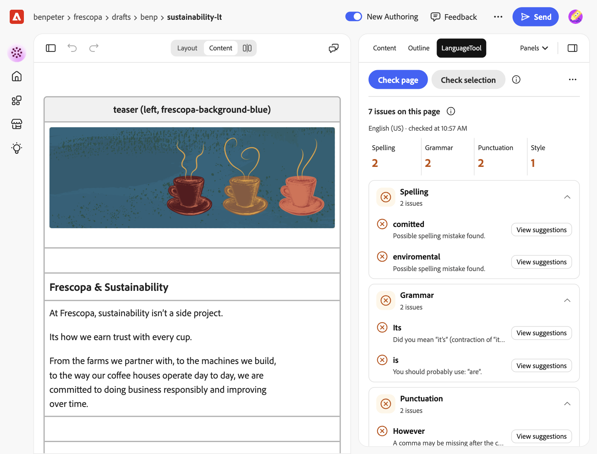
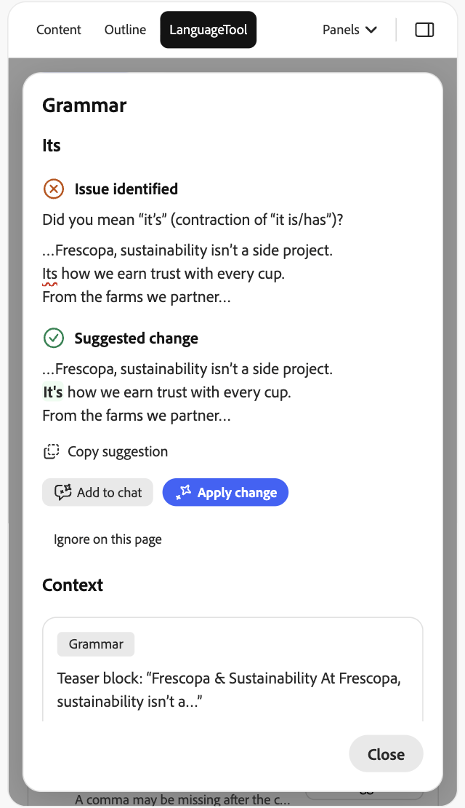
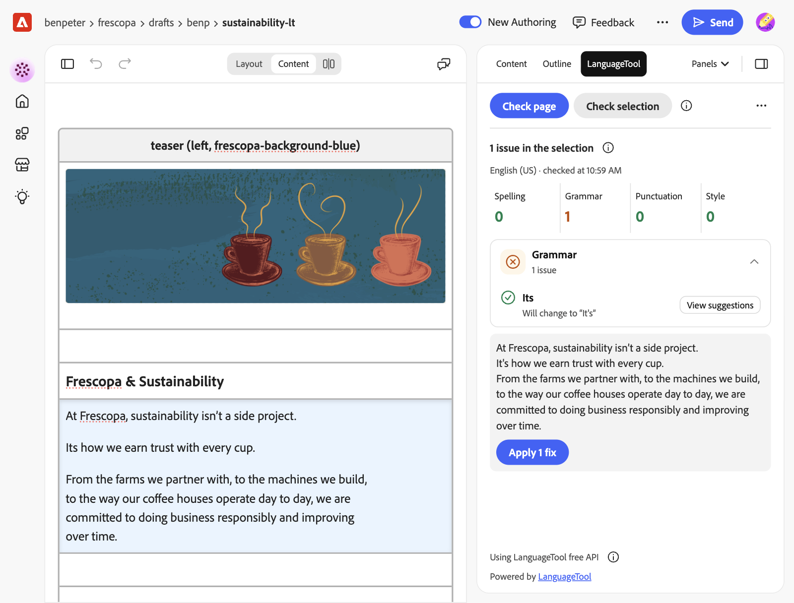
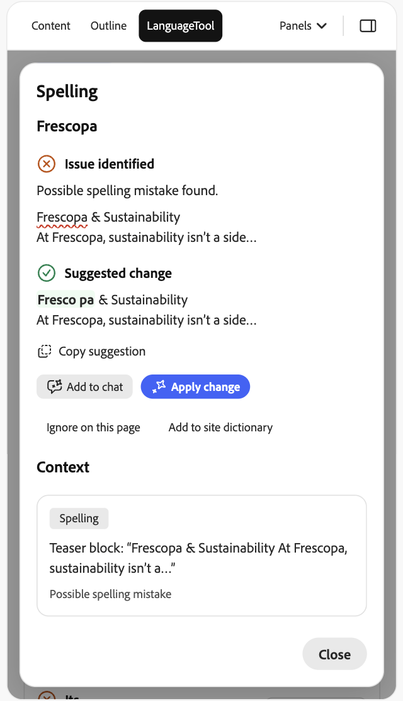
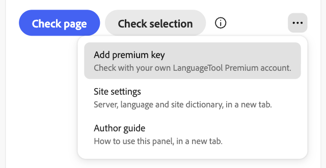

# LanguageTool: author guide

The LanguageTool panel proofreads the page you are editing. It finds spelling
mistakes, grammar slips, wrong punctuation and wordy phrases in more than 30
languages, and helps you fix them. Your site admin picks the LanguageTool server; the
line at the bottom of the panel says which one, for example "Using LanguageTool free
API".

## Open the panel

Open a page in Workspace, then choose **Panels** > **LanguageTool** in the right-hand
panel. If LanguageTool isn't in the menu, ask your site admin to add it.

## Check the page

Choose **Check page**. The first time, the panel tells you where your text goes.
Choose **Continue**.

- The counts at the top show the spelling, grammar, punctuation and style issues.
- Each type with issues has its own section. An issue shows the flagged words and
  LanguageTool's explanation, in the language of the page.
- Choose a section's heading to fold it away. With more than five issues in a
  section, the arrows below it page through them.

## Look at one issue

Choose **View suggestions**, or **View** when LanguageTool has no suggestion.

- **Issue identified** shows LanguageTool's explanation and the sentence with the
  flagged words underlined.
- **Suggested change** shows the sentence with the fix. When there are several fixes,
  pick one.
- **Context** names the paragraph or block the issue is in, with a few words on
  either side of the issue.

The arrows at the bottom go to the next issue of the same type. **Close** or Escape
closes the issue.

To make the fix after **Check page**:

- **Copy suggestion** copies the fixed words. Select the words in the page and paste.
- **Add to chat** puts a request for this one change into the Workspace assistant's
  prompt. Check it and send it yourself.
- **Apply change** sends that request to the assistant right away and asks it to make
  the change. Check the page afterwards.
- Or select the text in the page and use **Check selection** (see below).

**Add to chat** and **Apply change** show only when your site has Workspace chat.

## Fix a selection

1. Select one or more paragraphs in the page.
2. Choose **Check selection**.
3. Open an issue and choose **Use this fix**. The issue turns green and says what it
   will change to.
4. Choose **Apply 1 fix** (or **Apply 3 fixes**, and so on) below the list. Above the
   button, the panel shows the text as it will be.

The panel replaces only the selected text, and only if the selection hasn't changed
since you checked it. Inside bold text or links, select whole paragraphs.

## Names LanguageTool doesn't know

Brand and product names, like "Frescopa", show up as spelling mistakes. Open the
issue, then:

- **Add to site dictionary** adds the word for every author on the site. It shows on
  spelling issues, and only if you can change the site config.
- **Ignore on this page** hides the issue, and every other issue with the same words
  and the same LanguageTool rule, until you close the panel.

## Ask the assistant to fix everything

After **Check page**, **Ask the assistant to fix these** below the list puts the
issues into the assistant's prompt: the flagged words, where they are and the suggested
fix, for up to 40 issues. Check the prompt and send it. The prompt asks the assistant
to keep names and intended wording. The button shows only when your site has Workspace
chat.

## Use your own Premium account

Your site may use LanguageTool Premium, or you may have your own Premium account.
Premium finds more issues and checks longer texts.

1. Choose **⋯** next to the buttons, then **Add premium key**.
2. Enter your LanguageTool login email and your API key. **Get an API key** opens the
   LanguageTool page where you make one.
3. Choose **Save key**.

The key stays in this browser and goes only to LanguageTool Premium. The line at the
bottom then says "Using LanguageTool Premium, with your key". To remove the key,
choose **⋯** > **Remove premium key**. On another computer or browser, add it again.

## Things to know

- The panel checks only when you click. Nothing is sent while you type.
- Results don't change while you edit. Check again after you change the page.
- Page metadata isn't checked.
- The (i) buttons tell you more: next to the check buttons, next to the result
  heading, and next to the "Using" line at the bottom. **⋯** > **Author guide** opens
  this guide.
- The free server allows about 20 checks a minute per network. If the panel says the
  limit was reached, wait a minute.
